# Nest-Worth: architecture and flow

This file shows how the project is put together and what happens, file by file,
when a user does something. Diagrams are Mermaid, they render on GitHub (in VS
Code you need the "Markdown Preview Mermaid Support" extension). Every flow also
has a numbered list, so it is readable without the diagrams.

Contents:

1. [Big picture](#1-big-picture)
2. [Backend layers](#2-backend-layers)
3. [Frontend layers](#3-frontend-layers)
4. [Database tables](#4-database-tables)
5. [Flow: life of one API request](#5-flow-life-of-one-api-request)
6. [Flow: sign up and log in](#6-flow-sign-up-and-log-in)
7. [Flow: opening a protected page](#7-flow-opening-a-protected-page)
8. [Flow: dashboard and the plan numbers](#8-flow-dashboard-and-the-plan-numbers)
9. [Flow: adding or editing a debt](#9-flow-adding-or-editing-a-debt)
10. [Flow: asking the AI coach](#10-flow-asking-the-ai-coach)
11. [Flow: importing a bank statement](#11-flow-importing-a-bank-statement)
12. [Flow: the daily note](#12-flow-the-daily-note)
13. [Flow: stress test](#13-flow-stress-test)
14. [Flow: errors](#14-flow-errors)
15. [Explaining it in an interview](#15-explaining-it-in-an-interview)
16. [Rules: where new code goes](#16-rules-where-new-code-goes)
17. [Where do I find...](#17-where-do-i-find)

---

## 1. Big picture

Three parts:

- **frontend/** - React app running in the browser
- **backend/** - Express API with a SQLite database
- **shared/** - plain JavaScript money maths, imported by both

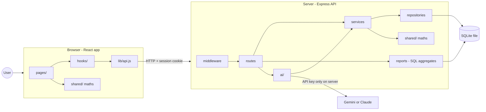

Why `shared/` exists: the browser needs the maths to update numbers instantly
(moving a slider), and the server needs the same maths for the AI coach. One
copy means they can never give different answers.

---

## 2. Backend layers

A request goes down through these layers. Each layer only talks to the one
below it.

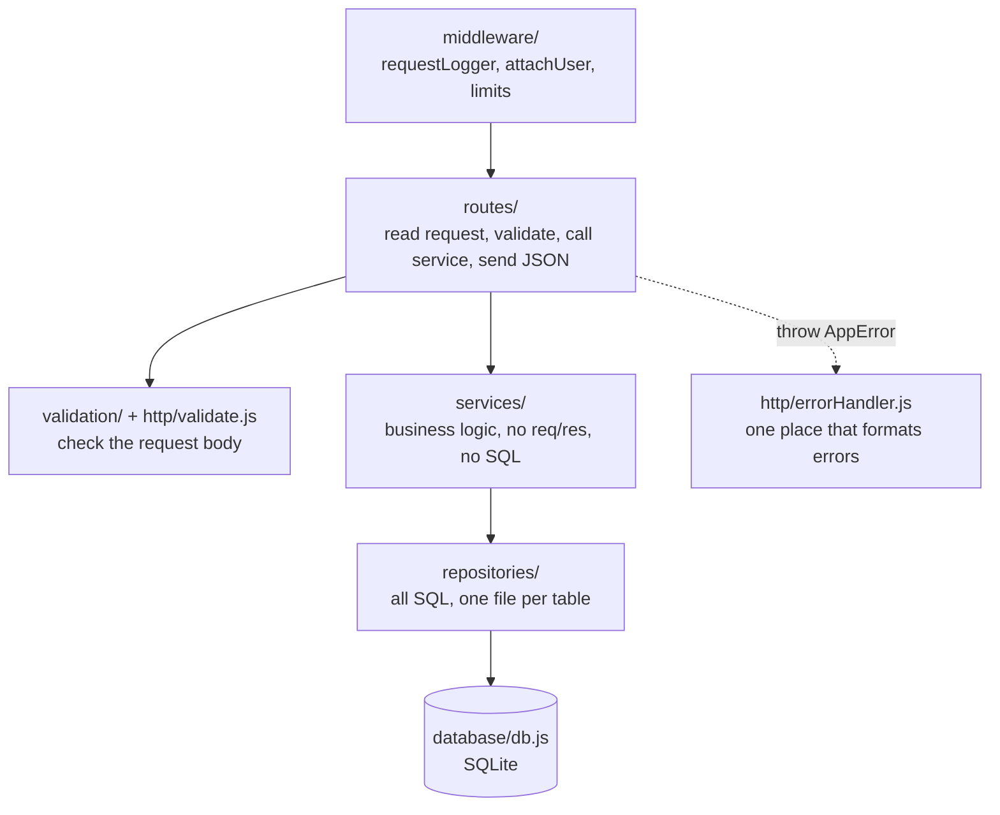

| Layer | Folder | Job | Should not |
|---|---|---|---|
| Config | [config.js](../backend/src/config.js) | Reads all env variables | Be skipped by using `process.env` elsewhere |
| Middleware | [middleware/](../backend/src/middleware/) | Logging, finding the user, rate limits | Have business logic |
| Routes | [routes/](../backend/src/routes/) | HTTP in and out | Have SQL or maths |
| Validation | [validation/](../backend/src/validation/) | Rules for request bodies | Touch the database |
| Services | [services/](../backend/src/services/) | Business logic | Know about `req`, `res` or SQL |
| Repositories | [repositories/](../backend/src/repositories/) | SQL and turning rows into objects | Have business logic |
| Reports | [reports/](../backend/src/reports/) | Read-only SQL (averages, totals, recap) | Write anything |
| AI | [ai/](../backend/src/ai/) | Prompt, agent loop, tools, providers | Do maths itself |
| Errors | [http/](../backend/src/http/) | `AppError` and the error handler | Send stack traces to the browser |

Order of middleware in [app.js](../backend/src/app.js):

1. `requestLogger` - gives the request an id and logs it with the time taken
2. `cors` - only allows the frontend's origin, with cookies
3. `express.json` - reads the body (2mb for statement import, 16kb for the rest)
4. `cookieParser` - reads cookies
5. `attachUser` - looks up the session cookie, sets `req.user` (or `null`)
6. the routes under `/api/...`
7. `notFoundHandler` then `errorHandler`

---

## 3. Frontend layers

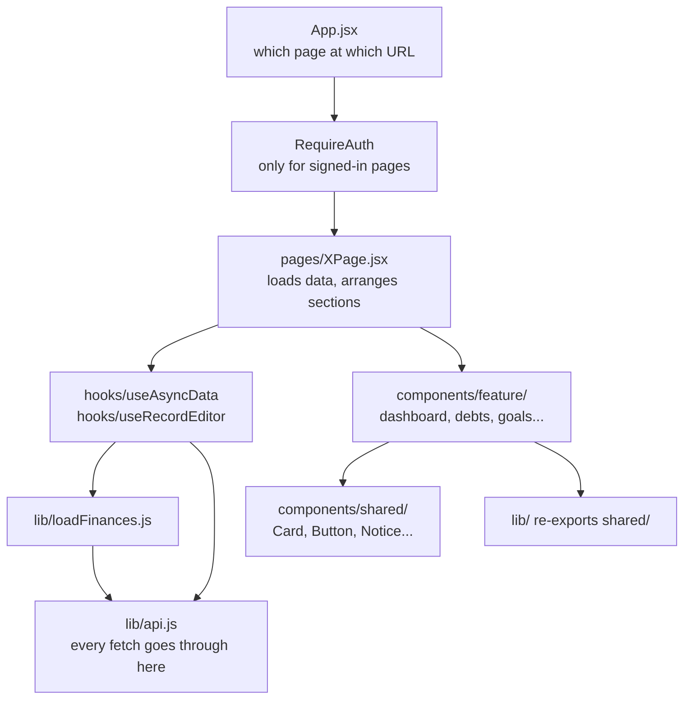

| Layer | Folder | Job |
|---|---|---|
| Routes | [App.jsx](../frontend/src/App.jsx) | Maps URL to page, wraps private pages in `RequireAuth` |
| Pages | [pages/](../frontend/src/pages/) | Load data and lay out sections |
| Feature components | [components/](../frontend/src/components/) | One folder per page area |
| Shared UI | [components/shared/](../frontend/src/components/shared/) | Card, Button, Notice, form fields |
| Layout | [components/layout/](../frontend/src/components/layout/) | App shell, sidebar, tabs, loading/error |
| Hooks | [hooks/](../frontend/src/hooks/) | Loading data and editing records |
| API client | [lib/api.js](../frontend/src/lib/api.js) | URLs, cookies, one response shape |
| Theme | [tailwind.config.js](../frontend/tailwind.config.js), [global.css](../frontend/src/styles/global.css) | All colours and fonts |

Every function in `api.js` returns the same shape, so pages never need try/catch:

```js
{ ok: true,  data }
{ ok: false, error, field, code, status }
```

---

## 4. Database tables

Defined in [schema.sql](../backend/src/database/schema.sql). Every table except
`users` has a `user_id` with `ON DELETE CASCADE`, so deleting a user deletes
everything they own.

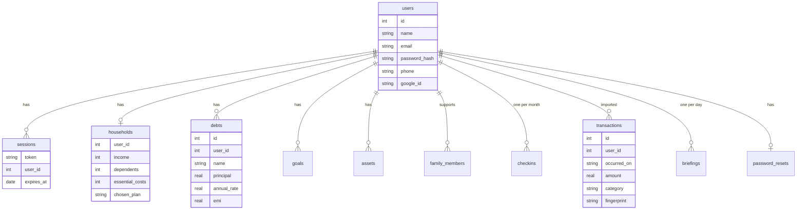

`otp_codes` is keyed by phone number, since the person may not have an account
yet when the code is sent.

(Only the main columns are shown. See `schema.sql` for all of them.)

---

## 5. Flow: life of one API request

Example: `GET /api/debts`

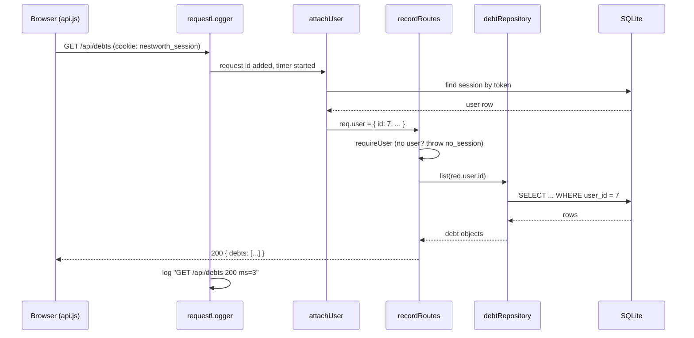

Steps:

1. [api.js](../frontend/src/lib/api.js) `request()` calls `fetch` with `credentials: 'include'` so the cookie is sent.
2. [requestLogger.js](../backend/src/middleware/requestLogger.js) gives the request an id (`X-Request-Id`) and starts a timer.
3. [auth.js](../backend/src/middleware/auth.js) `attachUser` reads the cookie and calls `findUserByToken` in [sessionService.js](../backend/src/services/sessionService.js). Expired sessions are deleted here.
4. [recordRoutes.js](../backend/src/routes/recordRoutes.js) runs `requireUser`, then calls the repository with `req.user.id`. The user id never comes from the request body or URL.
5. [ownedRecordRepository.js](../backend/src/repositories/ownedRecordRepository.js) runs the SQL with `WHERE user_id = ?`.
6. JSON goes back, the logger prints one line with status and time.

---

## 6. Flow: sign up and log in

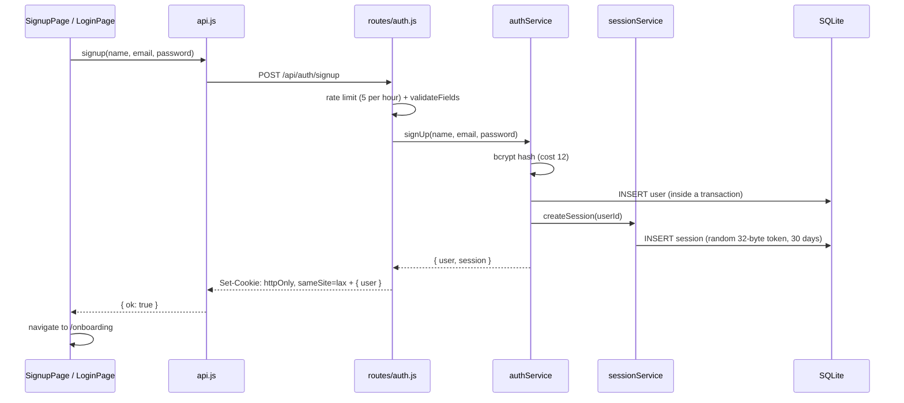

Login is the same, except `logIn` compares the password with `bcrypt.compareSync`
and gives the same error for "wrong password" and "no such email".

**Phone OTP:**

1. `POST /api/auth/otp/send` - [otpService.js](../backend/src/services/otpService.js) makes a 6 digit code, stores its **bcrypt hash**, and "sends" it (prints it in the terminal for now). The response is only `{ sent: true }`.
2. `POST /api/auth/otp/verify` - checks the typed code against the hash (wrong guesses are counted). If it matches, the code is deleted and a session is created. New phone number = new account.

**Google:** the frontend gets a Google credential, the backend checks it with
Google's token info endpoint in `authService.logInWithGoogle`, then finds or creates the user.

**Forgot / reset password:**

1. `POST /api/auth/forgot` always answers the same message, account or not.
2. If the account exists, a random token is made, its hash is stored, and the link is "emailed" (printed in the terminal).
3. `POST /api/auth/reset` checks the token, sets the new password, deletes **all** sessions for that user, and creates a new one. All inside one transaction.

**Log out:** deletes the session row and clears the cookie.

---

## 7. Flow: opening a protected page

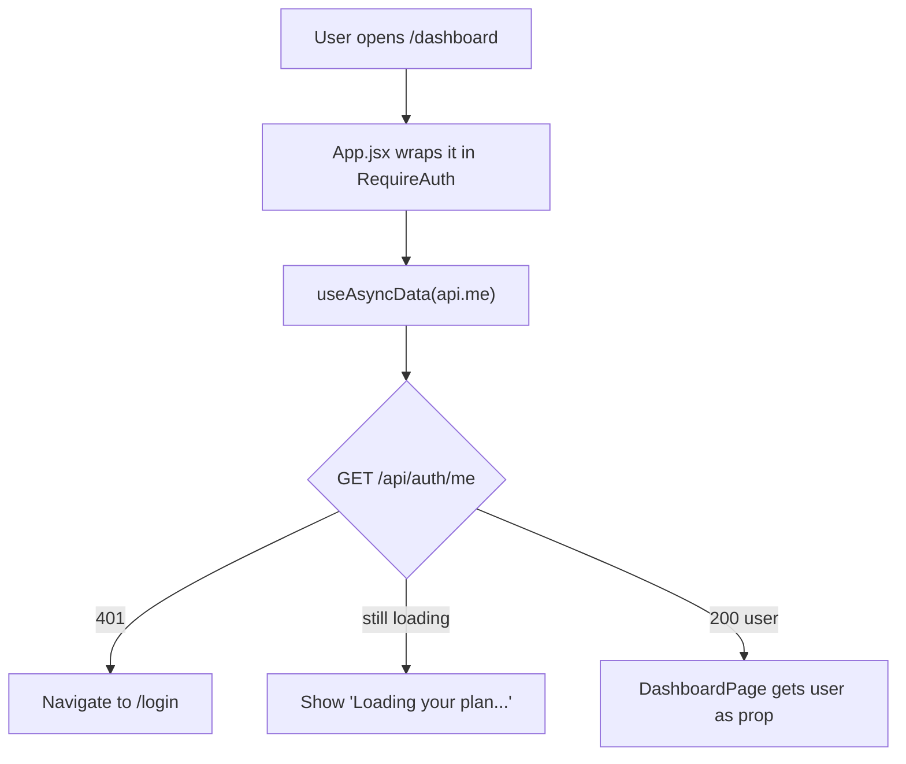

[RequireAuth.jsx](../frontend/src/components/auth/RequireAuth.jsx) only decides
what to **show**. The real protection is `requireUser` on the server. Someone
could skip the React check, but the API would still refuse them.

If the session expires while a page is open, the next request comes back with
`code: 'no_session'` and `api.js` sends the browser to `/login`. A wrong password
is also a 401 but a different code, so it doesn't redirect.

---

## 8. Flow: dashboard and the plan numbers

This is the most important flow, because every money number in the app comes
from one function: `summariseFinances` in [shared/finances.js](../shared/finances.js).

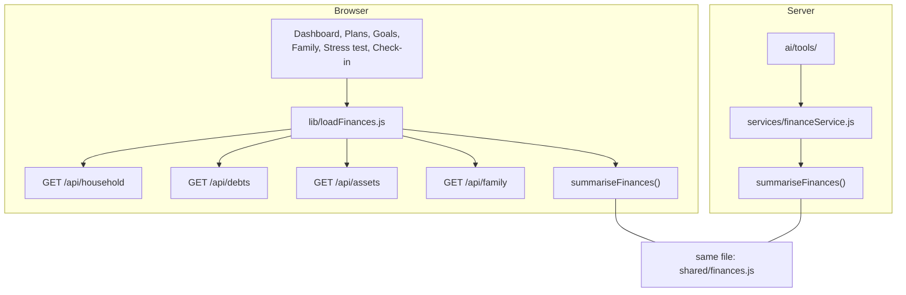

Steps on the dashboard:

1. [DashboardPage.jsx](../frontend/src/pages/DashboardPage.jsx) calls `loadDashboard`, which runs `loadFinances()`, `getGoals()` and `getCheckins()` in parallel.
2. [loadFinances.js](../frontend/src/lib/loadFinances.js) fetches household, debts, assets and family in parallel. If **any** of them fails, the whole thing fails (drawing a plan without the debts would look right but be wrong).
3. If onboarding is done (`household.isSaved`), it calls `summariseFinances`.
4. `summariseFinances` does:
   - `buildHouseholdPlan` - takes income, subtracts family support, EMIs, rent and bills, then splits what's left into spend / save / invest ([plan.js](../shared/plan.js))
   - `summariseDebts` - order by interest rate, payoff dates ([debt.js](../shared/debt.js))
   - `summariseNetWorth` ([networth.js](../shared/networth.js))
   - `safetyNet` - how many months of costs your cash covers ([goals.js](../shared/goals.js))
   - `buildScenarios` + `applyChosenPlan` - the 15 year plans ([scenarios.js](../shared/scenarios.js))
5. Dashboard components (`components/dashboard/`) only display these numbers. They don't calculate their own.

The server does the same thing in [financeService.js](../backend/src/services/financeService.js)
`readFinances(userId)`: reads the same tables through repositories and calls the
same `summariseFinances`. That is why the AI and the pages always agree.

---

## 9. Flow: adding or editing a debt

Debts, goals, assets and family members all work the same way.

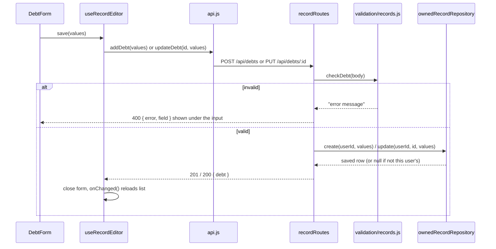

Steps:

1. Frontend validation gives quick feedback. Account fields use [shared/accountFields.js](../shared/accountFields.js), the same file the backend uses, so both sides refuse the same things.
2. [useRecordEditor.js](../frontend/src/hooks/useRecordEditor.js) knows if we're adding (`target === 'new'`) or editing, and calls the right API function.
3. Backend validation in [validation/records.js](../backend/src/validation/records.js) is the real check.
4. `update` and `remove` use `WHERE id = ? AND user_id = ?`. If the id belongs to someone else, nothing matches and the API says 404. It doesn't even admit the id exists.
5. After saving, the page reloads its data with `useAsyncData`'s `reload()`.

---

## 10. Flow: asking the AI coach

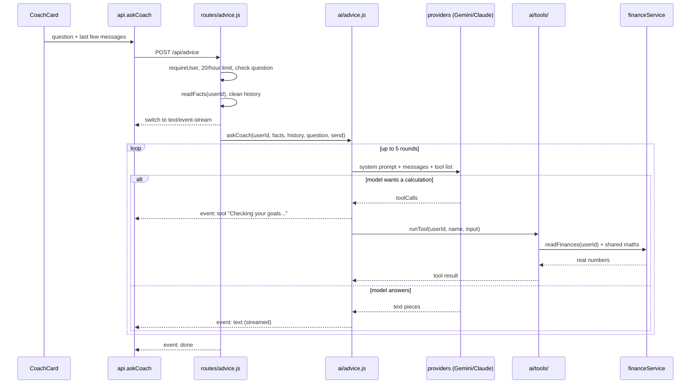

Steps:

1. [routes/advice.js](../backend/src/routes/advice.js) checks everything that could be a 400 **before** starting the stream, because once streaming starts the status is already 200.
2. [ai/facts.js](../backend/src/ai/facts.js) `readFacts` builds a text summary of the user's finances for the prompt.
3. `cleanHistory` keeps only plain text turns from the browser, so a browser can't fake a tool result.
4. [ai/advice.js](../backend/src/ai/advice.js) runs the loop. It uses its own message format (`{role, text}`, `{toolCalls}`, `{toolResults}`).
5. [providers/index.js](../backend/src/ai/providers/index.js) picks Gemini or Claude based on which key is in `.env`. [gemini.js](../backend/src/ai/providers/gemini.js) and [claude.js](../backend/src/ai/providers/claude.js) convert the message format.
6. Tools are in [ai/tools/](../backend/src/ai/tools/), one file each: `simulateExtraPayment.js`, `simulateHouseholdChange.js`, `checkGoals.js`, `comparePlans.js`, `spendingTrend.js`, `emergencyFund.js`, `stressTest.js`. [tools/index.js](../backend/src/ai/tools/index.js) lists them and runs the one the model asks for. Each tool takes the user id from the session, never from the model.
7. The answer is streamed to the browser as Server-Sent Events, so text appears as it is written.

The main idea: **the model picks which calculation to run, the code does the maths.**

---

## 11. Flow: importing a bank statement

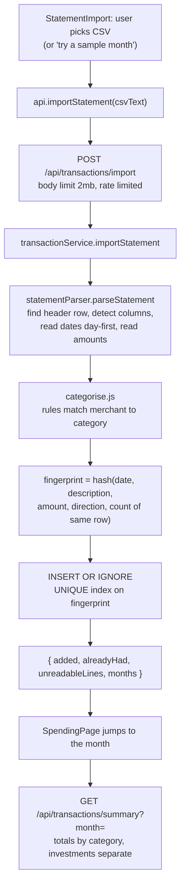

Files: [statementParser.js](../backend/src/services/statementParser.js),
[categorise.js](../backend/src/services/categorise.js),
[transactionService.js](../backend/src/services/transactionService.js),
[transactionRepository.js](../backend/src/repositories/transactionRepository.js).

Uploading the same file twice adds 0 rows because the fingerprints already exist.

---

## 12. Flow: the daily note

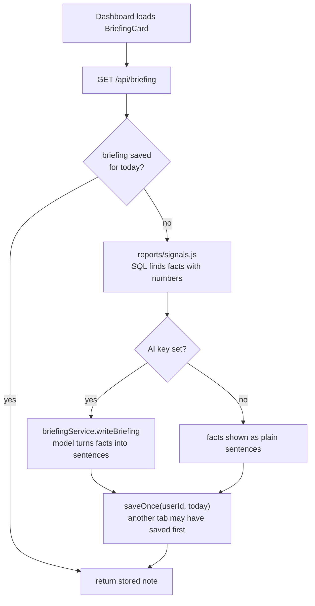

Facts come from SQL, the model only writes them up. So the model can't make up
a fact, and the same data always gives the same facts.

---

## 13. Flow: stress test

Runs fully in the browser with [shared/shocks.js](../shared/shocks.js). No API
call is needed after the finances are loaded.

1. [StressTestPage.jsx](../frontend/src/pages/StressTestPage.jsx) loads finances with `loadFinances`.
2. The user picks a shock (`job_loss`, `income_cut`, `medical`, `family_support`) and adjusts it with sliders.
3. `runShock` walks cash forward 12 months:
   - normal month: income - rent/bills - family - EMI - spending - investing
   - crisis month: shock income - rent/bills - family - EMI - (spending x 50%) - shock cost
4. Result: **breaks** (cash below 0), **tight** (lowest point under 1 month of costs), or **safe**, plus the month cash runs out and how much more savings would fix it.

The dashboard's "how many shocks you survive" uses `runStandardShocks`, and the
AI's `stress_test` tool calls the same `runShock` on the server.

---

## 14. Flow: errors

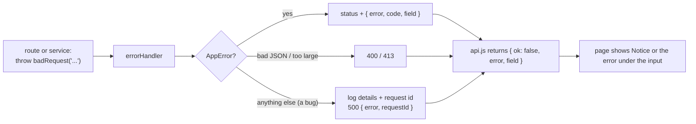

- Routes and services only `throw`. [errorHandler.js](../backend/src/http/errorHandler.js) is the only place that turns errors into responses.
- Error helpers are in [errors.js](../backend/src/http/errors.js): `badRequest`, `notFound`, `noSession`, `tooManyRequests`.
- A 500 never sends the stack trace, only a `requestId` you can search for in the logs.
- In the frontend, a failed page load shows an error state instead of empty lists.

---

## 15. Explaining it in an interview

**One line:** a money planner for Indian families where one salary supports many
people. It builds a plan from real family costs, stress tests it, and has an AI
coach that uses the app's own calculations.

**Architecture in 30 seconds:**

> React frontend, Express + SQLite backend, and a `shared/` folder of money maths
> used by both. The backend is layered: routes, services, repositories. Every
> plan number comes from one function, `summariseFinances`, so the dashboard,
> every page and the AI coach always show the same numbers.

**Questions you will likely get, and where the answer is:**

| Question | Short answer | Where |
|---|---|---|
| Why sessions and not JWT? | Deleting the row logs a device out immediately, needed for "change password logs out other devices" | [sessionService.js](../backend/src/services/sessionService.js) |
| How do you stop one user seeing another's data? | User id always comes from the session, every query has `WHERE user_id = ?`, written once in a shared repository, with a test | [ownedRecordRepository.js](../backend/src/repositories/ownedRecordRepository.js) |
| Why is maths in `shared/`? | Browser needs it for instant sliders, server needs it for AI. One copy, no drift | [shared/finances.js](../shared/finances.js) |
| How does the AI avoid wrong numbers? | It calls tools, the tools do the maths with the same shared functions | [ai/tools/](../backend/src/ai/tools/) |
| Why SQLite? | No server to install. Plain SQL, so moving to Postgres is mostly a driver change | [db.js](../backend/src/database/db.js) |
| How does duplicate import work? | Fingerprint hash + UNIQUE index + `INSERT OR IGNORE` | [transactionRepository.js](../backend/src/repositories/transactionRepository.js) |
| Why rules and not AI for categories? | Instant, free, same answer every time | [categorise.js](../backend/src/services/categorise.js) |
| How would it scale? | Redis for rate limits, Postgres for multiple servers, background job for daily notes | [SYSTEM_DESIGN.md](SYSTEM_DESIGN.md) section 9 |
| How do you find a bug? | Request id in logs, each number has one function and one test file | [DEBUGGING.md](DEBUGGING.md) |

---

## 16. Rules: where new code goes

These are the rules the code follows. If you keep to them, a bug can be placed
in one layer just from what it looks like.

**Backend**

| Rule | Why |
|---|---|
| Routes only read the request, call one service or repository, and send JSON | So HTTP problems and logic problems are in different files |
| SQL only in `repositories/` (writes and simple reads) or `reports/` (read-only totals) | One place to look when a query is wrong |
| Services never see `req` or `res` | They can be tested by calling a function, no server needed |
| Every query filters on `req.user.id`, never an id from the body or URL | One user can never read another user's data |
| Errors are thrown (`badRequest`, `notFound`...), never sent by hand | `errorHandler.js` is the only place that formats them |
| Env variables only through `config.js` | One file shows every setting |
| Rate limits only in `middleware/limits.js` | One table answers "how often can somebody do X" |
| Time lengths from `utils/time.js` | `15 * 60 * 1000` typed in five places is five chances to get it wrong |
| One AI tool per file in `ai/tools/`, listed in `tools/index.js` | Adding a tool means one new file and one new line |

**Shared (`shared/`)**

| Rule | Why |
|---|---|
| Any calculation both sides need lives here | The page and the AI coach can never disagree |
| Plan numbers only come from `summariseFinances` | Five copies of the plan once drifted apart |
| Formatting (money, dates) only in `format.js` | "₹13.8 L" looks the same everywhere |
| Validation rules both sides check (account fields, family members) live here | The form can't accept what the API refuses |
| No React, no database, no `fetch` | Plain functions, easy to test |

**Frontend**

| Rule | Why |
|---|---|
| Every request goes through `lib/api.js` | One file knows URLs, cookies and the response shape |
| Pages load data with `useAsyncData`, edit lists with `useRecordEditor` | Every page handles loading and errors the same way |
| A component used by more than one page goes in `components/shared/` | No copies of the same card in two folders |
| Errors are shown with `<Notice tone="error">` | One look for every error message |
| Colours only from `tailwind.config.js` tokens | One theme for the whole app |
| `lib/` files are plain functions, no React | They can be tested without rendering anything |

Some components call `api` themselves (settings sections, the coach card, the
statement import). That's fine when the call is that component's own action,
like saving a form. Loading a page's main data is still the page's job.

**Before writing any helper, search for it first** (`grep -rn "function name"`).
If it already exists, import it. If it exists in a component, move it to
`shared/` or `components/shared/` and import it in both places.

---

## 17. Where do I find...

| Looking for | File |
|---|---|
| Which URL shows which page | [frontend/src/App.jsx](../frontend/src/App.jsx) |
| Which API routes exist | [backend/src/app.js](../backend/src/app.js), then the comment at the top of each file in `routes/` |
| How the monthly plan is split | `buildPlan` in [shared/plan.js](../shared/plan.js) |
| Every number on the dashboard | `summariseFinances` in [shared/finances.js](../shared/finances.js) |
| Debt payoff dates and interest | [shared/debt.js](../shared/debt.js) |
| Goals and the safety net | [shared/goals.js](../shared/goals.js) |
| The 15 year plans | [shared/scenarios.js](../shared/scenarios.js) |
| The stress test | [shared/shocks.js](../shared/shocks.js) |
| How "₹13.8 L" or "August 2026" is written | [shared/format.js](../shared/format.js) |
| Email, password, phone, OTP rules | [shared/accountFields.js](../shared/accountFields.js) |
| Debt, goal, asset, check-in rules | [backend/src/validation/records.js](../backend/src/validation/records.js) |
| Sign up, log in, reset password | [backend/src/services/authService.js](../backend/src/services/authService.js) |
| Sessions and cookies | [sessionService.js](../backend/src/services/sessionService.js), [http/cookies.js](../backend/src/http/cookies.js) |
| Rate limits | [backend/src/middleware/limits.js](../backend/src/middleware/limits.js) |
| Database tables | [backend/src/database/schema.sql](../backend/src/database/schema.sql) |
| New columns added later (migrations) | [backend/src/database/db.js](../backend/src/database/db.js) |
| Reading a bank CSV | [backend/src/services/statementParser.js](../backend/src/services/statementParser.js) |
| Spending categories | [shared/categories.js](../shared/categories.js), rules in [categorise.js](../backend/src/services/categorise.js) |
| SQL reports (averages, totals, recap) | [backend/src/reports/](../backend/src/reports/) |
| The AI prompt | [backend/src/ai/prompt.js](../backend/src/ai/prompt.js) |
| What the AI can calculate | [backend/src/ai/tools/](../backend/src/ai/tools/) |
| Which AI model is used | [backend/src/ai/providers/index.js](../backend/src/ai/providers/index.js) |
| Error format | [backend/src/http/errors.js](../backend/src/http/errors.js), [errorHandler.js](../backend/src/http/errorHandler.js) |
| Colours and fonts | [frontend/tailwind.config.js](../frontend/tailwind.config.js), [global.css](../frontend/src/styles/global.css) |
| Sidebar and section tabs | [frontend/src/lib/navigation.js](../frontend/src/lib/navigation.js) |
